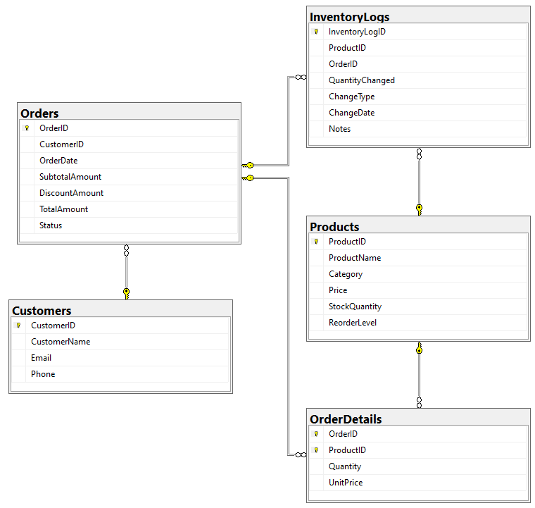

# Inventory and Order Management System

A SQL Server database for an e-commerce company that stores customers and products, processes multi-product orders with bulk discounts, keeps stock levels up to date, logs every inventory change for auditing, replenishes low-stock products, and reports on orders, stock and customer spending.

### Project Links

| Deliverable              | Link                                          |
| ------------------------ | --------------------------------------------- |
| **Project Instructions** | [View Instructions](instructions.md)          |
| **ERD Diagram**          | [View ERD](erd_diagram.png)                   |
| **Run Everything**       | [run_all.sql](run_all.sql)                    |

---

## Tools and Technologies

- **Microsoft SQL Server Express:** relational database storing customers, products, orders, order details and inventory logs.
- **SQL Server Management Studio (SSMS):** used to create the database, run the scripts and test the system.
- **Transact-SQL (T-SQL):** used for the schema, constraints, stored procedures, trigger, views, indexes and reports.
- **Visual Studio Code (VS Code):** used to organize and edit the SQL scripts and documentation.
- **Git and GitHub:** version control and hosting.

---

## Repository Structure

```text
SQL-Inventory-Order-Management/
├── 01_database_design/
│   ├── 01_create_schema.sql
│   ├── 02_create_indexes.sql
│   └── 03_log_initial_stock_trigger.sql
├── 02_sample_data/
│   └── 01_insert_sample_data.sql
├── 03_stored_procedures/
│   ├── 01_place_order.sql
│   ├── 02_test_place_order.sql
│   ├── 03_replenish_stock.sql
│   └── 04_test_replenishment.sql
├── 04_reporting/
│   ├── 01_create_views.sql
│   ├── 02_order_summary.sql
│   ├── 03_low_stock_report.sql
│   ├── 04_customer_spending_tiers.sql
│   └── 05_inventory_history.sql
├── run_all.sql
├── erd_diagram.png
├── instructions.md
└── README.md
```

| File | Purpose |
| ---- | ------- |
| `01_create_schema.sql` | Creates the database and the five tables with their primary keys, foreign keys and check constraints. Drops existing tables first so it can be re-run. |
| `02_create_indexes.sql` | Adds indexes on the foreign key columns to keep joins and lookups fast as the data grows. |
| `03_log_initial_stock_trigger.sql` | Trigger that logs the initial stock of every product when it is inserted. |
| `01_insert_sample_data.sql` | Inserts 5 sample customers and 8 sample products. |
| `01_place_order.sql` | `PlaceOrder` procedure: validates the order, calculates the total and bulk discount, saves the order and its items, deducts stock and logs the changes. |
| `02_test_place_order.sql` | Places a sample order with two products. |
| `03_replenish_stock.sql` | `ReplenishStock` (one product, chosen quantity) and `ReplenishLowStock` (finds and tops up every low-stock product). |
| `04_test_replenishment.sql` | Demonstrates both replenishment procedures and shows the inventory log. |
| `01_create_views.sql` | Views for order summaries, low-stock products, and customer spending tiers. |
| `02_order_summary.sql` | Order summary per customer. |
| `03_low_stock_report.sql` | Products below their reorder level, most urgent first. |
| `04_customer_spending_tiers.sql` | Spending and tier per customer, plus totals per tier. |
| `05_inventory_history.sql` | Full inventory audit trail, and a check that stock matches the logged changes. |
| `run_all.sql` | Runs every script above in the correct order. |

---

## How to Run

**Requirements:** SQL Server (Express edition or higher, version 2016 or later) and SSMS.

**Option 1: Run everything at once**

1. Open `run_all.sql` in SSMS.
2. Turn on SQLCMD Mode: **Query** menu → **SQLCMD Mode**.
3. Change the `ProjectPath` line to the folder where you cloned this repository.
4. Execute (F5).

**Option 2: Run the scripts one by one**, in this order:

1. `01_database_design/` (all three files, in order)
2. `02_sample_data/01_insert_sample_data.sql`
3. `03_stored_procedures/01_place_order.sql` and `03_replenish_stock.sql`
4. `04_reporting/01_create_views.sql`
5. `03_stored_procedures/02_test_place_order.sql`
6. `04_reporting/02` to `04` (reports)
7. `03_stored_procedures/04_test_replenishment.sql`
8. `04_reporting/05_inventory_history.sql`

> **Note:** `01_create_schema.sql` drops and re-creates all tables, so running it deletes any existing data in the `InventoryOrderManagement` database.

---

## Database Design



| Table | Description |
| ----- | ----------- |
| **Customers** | Customer name, email (unique) and phone number. |
| **Products** | Name, category, price, stock quantity and reorder level. |
| **Orders** | Customer, order date, subtotal, discount, total and status. |
| **OrderDetails** | The products in each order, with quantity and the unit price at the time of the order. |
| **InventoryLogs** | Every stock change: product, quantity changed, type of change, date, and the related order (if any). |

Data integrity is enforced with constraints:

- **Foreign keys:** every order belongs to an existing customer, and every order line and log entry refers to an existing product (and order, where relevant).
- **Check constraints:** prices, stock and amounts can't be negative, the total must equal subtotal minus discount, and log entries must have a valid change type. Order-related log entries must also reference an order.
- **Composite primary key on `OrderDetails`:** `(OrderID, ProductID)` prevents the same product appearing twice in one order.

---

## How the Requirements Are Met

| Requirement | Implementation |
| ----------- | -------------- |
| Process multi-product orders | `PlaceOrder` takes a list of products and quantities as one table-valued parameter (`OrderItemType`). |
| Deduct stock and calculate totals | `PlaceOrder` checks stock, calculates the subtotal, discount and total, deducts stock and saves the order lines, all in one transaction. If any step fails, nothing is saved. |
| Bulk discounts | Orders with **5 or more items** in total get a **10% discount**. Both values are procedure parameters with these defaults. |
| Log every inventory change | Orders (`PlaceOrder`), replenishments (`ReplenishStock`, `ReplenishLowStock`) and new products (trigger) all write to `InventoryLogs`. |
| Full audit history | `05_inventory_history.sql` lists every change and checks that each product's stock equals the sum of its logged changes. |
| Order summaries per customer | View `vw_OrderSummary`. |
| Flag low-stock products | View `vw_LowStockProducts`: any product with stock below its reorder level. |
| Replenish low-stock products | `ReplenishLowStock` finds every low-stock product and tops it up to twice its reorder level (configurable). |
| Customer tiers | View `vw_CustomerSpending`: **Gold** (200 or more), **Silver** (100 to 199.99), **Bronze** (below 100). Only completed orders count. |
| Automation | Stock updates and total calculation happen inside `PlaceOrder`, initial stock logging is handled by a trigger, and tiers are recalculated by the view every time it is queried. |
| Performance | Indexes on the foreign key columns used by the joins: `Orders(CustomerID)`, `OrderDetails(ProductID)`, `InventoryLogs(ProductID, ChangeDate)` and `InventoryLogs(OrderID)`. |

**Why the customer tier is calculated in a view instead of stored in a column:** a stored tier would have to be updated every time an order is placed, and could fall out of date. The view always calculates it from the current orders, so it is automatically correct.

---

## Example Results

Running `run_all.sql` on the sample data produces:

- **Order:** Alex Morgan orders 2 Wireless Keyboards (\$50 each) and 3 Wireless Mice (\$20 each). That is 5 items, so the bulk discount applies: subtotal \$160.00, discount \$16.00, **total \$144.00**.
- **Customer tiers:** Alex Morgan is **Silver** (\$144.00). The other customers have no orders yet and are **Bronze**.
- **Low stock (before replenishment):** USB-C Hub (8 of 10), Mechanical Keyboard (4 of 5), Webcam HD (3 of 5) and Headphones (0 of 10).
- **Replenishment:** USB-C Hub is topped up manually by 10 units. `ReplenishLowStock` then tops up the remaining three products to twice their reorder level, and the low-stock view becomes empty.
- **Audit check:** every product shows `OK`, meaning all stock changes were logged.